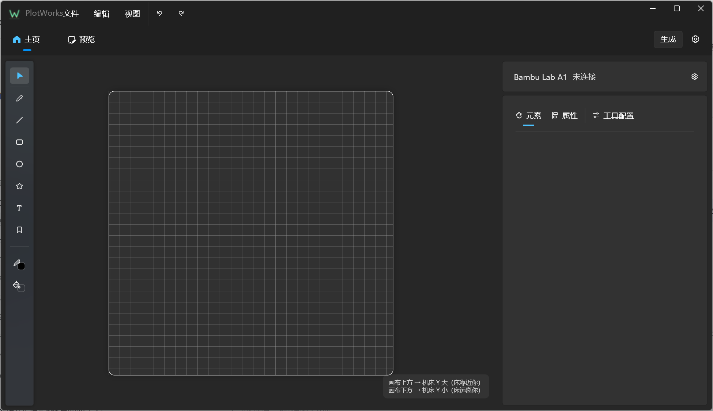

# PlotWorks 用户手册

适用版本 **1.0.0** ｜ Windows 10（v1809+）/ Windows 11 ｜ Bambu Lab A1

> 这份手册面向使用者。想了解实现细节、魔改范围或构建方式，看 [A1-README.md](A1-README.md)；
> 想快速了解项目全貌，看根目录的 [README.md](../README.md)。

---

## 1. 它能做什么，不能做什么

**能**：画图或导入图 → 生成 2D 刀路 → 通过局域网传到 A1 → 在打印机屏幕上启动。

**不能**：从局域网远程启动打印。A1 固件会直接拒绝这类指令，这是打印机的限制，不是软件缺陷。
上传完成后必须走到机器前面，在屏幕上点开始。

---

## 2. 安装与启动

发布包是一个压缩文件，解压到任意目录即可，不需要安装程序。

解压后应该看到：

```
PlotWorks.exe
Resources\Fonts\*.ttf        ← 5 款单线字体，删了中文就写不成单线
LICENSE.txt
README.md
```

双击 `PlotWorks.exe` 启动。

> **`Resources\Fonts\` 必须和 exe 放在一起。** 缺了这个目录程序还能开，但所有文字都会退化成
> 普通系统的空心轮廓字——而且界面上不会有任何提示，你只会发现"写出来的字是双线的"。

### 数据存在哪里

默认在 `%LocalAppData%\PlotWorks\`：打印机配置、工具参数、界面设置、日志都在这里。

**便携模式**：把整个程序目录改名为 `PlotWorks`（或 `PolyCut`），数据就会改写到该目录下的
`.PlotWorksData\`，整个文件夹可以拷到 U 盘带走。

> 从旧版本升级上来的用户：如果 `%LocalAppData%\IridiumIO\PolyCut\` 存在且新目录还是空的，
> 程序首次启动会自动把旧配置拷过来，打印机 IP / 访问码 / 序列号不用重填。

---

## 3. 物理准备：把笔或刀装上

软件只负责算出坐标和 Z 高度，笔（刀）怎么固定在工具头上是硬件问题。

需要一个能夹在工具头上的笔架或刀架，3D 打印模型在 Printables / Thingiverse 上能搜到。

> **强烈建议选带弹簧的。** 打印机的床面平面度远达不到"稳定刻透、稳定画实"的程度，
> 弹簧提供的柔性可以让笔尖始终贴着纸面，而不是有时悬空、有时压死。

### 量出工作高度

1. 先装好笔，手动把工具头挪到纸面附近；
2. 找一张纸垫在下面，用「点动」一点点下降，直到笔尖刚好在纸上画出痕迹；
3. 记下这个 Z 值，它就是你的**工作 Z**（`Z Height` / `Work Z`）；
4. 在右侧「工具配置」页签里把它填进去。

程序默认值是 **5 mm**（相对床面）。对 A1 来说 Z=0 就等于笔尖贴床，**不要填 0 或负数**——
负值会被程序直接拒绝，0 则等于每画一笔都在蹭床板。

---

## 4. 连接打印机

### 打印机端

1. 屏幕上进入 `设置 → 局域网模式`，开启局域网模式；
2. A1 还需要同时开启**开发者模式**；
3. 记下屏幕显示的 **IP 地址**、**访问码**（8 位）、**序列号**。

### 软件端

右上角齿轮 → **打印机配置** → `Bambu Lab A1 连接`：

| 字段 | 填什么 |
|---|---|
| 主机地址 | 打印机的局域网 IP，例如 `192.168.1.50` |
| 访问码 | 打印机屏幕上那 8 位码 |
| 序列号 | 打印机序列号 |

保存后，进入 `预览 → 打印机控制`，点 **连接**。右侧「实时状态」出现 State / Nozzle / Bed
就说明通了，日志写在 `%LocalAppData%\PlotWorks\a1.log`。

> 访问码等于打印机的完整控制权，它是明文保存在
> `%LocalAppData%\PlotWorks\Printers\*.json` 里的，不要提交、外传或截图分享。

**连接不会自动重连。** 断线后显示"未连接"，需要手动再点一次连接。

---

## 5. 对位：让软件坐标等于纸上的坐标

这一步决定了画出来的东西到底落在纸的哪里。

1. 点 **回零（`G28`）**。A1 归零后工具头停在床中心附近，软件会把当前位置记成约 `128 / 128`；
2. 用 **点动**（0.1 / 1 / 10 mm 步长，或圆盘）走到一个你已知的物理位置，比如纸的左下角；
3. 在「位置校准」里输入这个点的**实测坐标**，点 **设为当前位置**——累计坐标会被直接改成这个值；
4. 需要更精确的重复定位时，用 **捕获参考点**：把当前位置记成画布上的一个编号标记，
   它会随项目一起保存，拖动对象时还能吸附。

> **点动和四角移动是开环的**：发出去不等打印机确认。如果固件拒绝了某次移动（未归零、超行程），
> 软件里的坐标照样会累加，于是越走越偏。发现位置不对，用「位置校准」纠正，不要靠反复点动去凑。

配好之后，可以点「刀路四角」的几个按钮，让工具头依次走到已生成刀路的包围盒四角，
用来确认纸是不是贴在了正确的位置。

---

## 6. 界面导览



| 区域 | 内容 |
|---|---|
| 顶部 | `文件` / `编辑` / `视图` 菜单；右上「生成」按钮和齿轮（打印机配置） |
| 导航 | `主页`（画布）、`预览`（生成的刀路） |
| 左侧竖排 | 工具：选择、铅笔（自由绘制）、直线、矩形、圆、星形、文本、插入图片、橡皮 |
| 中间 | 画布，**1 单位 = 1 mm**，格线对应 256×256 的床面 |
| 右侧上方 | 当前打印机与连接状态 |
| 右侧下方 | `元素` / `属性` / `工具配置` 三个页签 |

画布右下角常驻一行方向提示：**画布上方是机床 Y 大（床靠近你），下方是 Y 小（远离你）**。
第一次用建议先画个方框测一下方向，别等画完才发现上下颠倒。

---

## 7. 画图

### 基本形状

选左侧工具，在画布上拖出形状。选中后可以在「属性」面板里改坐标、尺寸、描边和填充颜色。

### 选择与变换

- 单击选择，框选多选，属性面板里改数值可以**批量**平移选中的对象；
- 选中的对象四周有手柄，可以拖动缩放；上方圆形箭头是旋转；
- 右键菜单：`剪切` `复制` `粘贴` `全选` `阵列`，以及描边 / 填充颜色、`排列`（层级顺序）。

### 阵列

右键 → `阵列`，对话框里设行列数和间距，确认后一次性生成多个副本，并且**一步就能撤销**。

### 合并与组合

「元素」面板底部三个按钮：

- **合并 ▾** —— 布尔运算：`并集` / `交集` / `相减` / `排除`，结果是一个新的形状；
- **组合 ▾** —— `组合` / `解散组合`，只是把多个对象打包在一起移动，不改变几何；
- **删除**。

### 导入

`文件 → 导入 SVG/图片…`。位图（PNG / JPG / BMP）会先走矢量化（VTracer），
导入后建议检查一下轮廓数量——照片类图片矢量化出来的路径会非常多，刀路会慢得离谱。

---

## 8. 文字

用文本工具在画布上拖出一个文本框，然后直接输入。

### 字体

**新建文本框的默认字体是 Calibri，是系统字体（空心轮廓）。要写中文，第一件事就是切到带「单线 ·」
前缀的字体。** 字体下拉里最前面的 5 款就是：

| 显示名 | 风格 |
|---|---|
| 单线 · Script Simplex | 简体手写体，中文首选 |
| 单线 · Script Complex | 复杂手写体 |
| 单线 · Cursive | 连笔草书 |
| 单线 · Gothic English | 哥特英文 |
| 单线 · Roman Simplex | 罗马正体 |

**单线 = 一笔一根线**，刀路只走一遍；列表里的其他系统字体（Calibri、Arial 等）是闭合轮廓，
生成出来会沿内外两边各走一圈，速度慢好几倍，写出来也是空心字。

内置字库共 **6,779 个字形**（汉字 + 中文标点），覆盖 GB2312 一级字等常用字，外加完整 ASCII。

### 字号与排版

- 字号单位是 **pt**；中英文、标点、拼音声调（`ā á ǎ à`）可以混排；
- 行距逐行恒定，手动换行和自动折行一致；
- 顶部工具栏的 `中` / `右` 是段落对齐；字号可以自动收缩到框内。

### 有字写不出来？

生成时会弹窗列出**没有骨架数据的字**，并说明这一段会整体回退成轮廓字。
生僻字、繁体字、emoji 大概率不在字库里——换字，或者接受它变空心。

---

## 9. 刀路参数（工具配置）

右侧「工具配置」页签：

| 参数 | 含义 | 建议 |
|---|---|---|
| 工具模式 | `绘制`（Draw）/ `剪切`（Cut） | 笔绘选绘制；切割功能当前整体屏蔽 |
| Z 高度 | 落笔（落刀）高度 | 按实测填，见第 3 节 |
| 工具偏移 X / Y | 工具头安装偏移，两种模式各自再叠加 `切割偏移` / `绘制偏移` | 发现整体偏移时改这里 |
| 工作速度 / 移动速度 | mm/s | 笔绘可以从 40 / 60 起 |
| 走刀次数 | 同一路径重复几遍 | 刻透用 2–3 遍，笔绘 1 遍 |
| 每次走刀 Z 偏移 | 每遍之后 Z 变化量 | 正值上移、负值下移；切割厚料用略负的值逐次加深 |
| 曲线拟合精度 | 曲线离散精度 | 默认即可，太小会生成海量小线段 |
| 刀具直径 / 过切 / 切口补偿 | 刀片旋转与刀缝补偿 | 切割用，笔绘不用管 |
| 笔宽 / 笔宽补偿 / 填充轮廓重叠 | 笔迹宽度补偿 | 用粗笔填色时有用 |

> 生成前程序会检查几个明显会撞机的参数（Z 速度、走刀偏移、负的工作 Z），不合法就直接拒绝。

---

## 10. 生成与预览

画好之后点右上角 **生成**。生成成功会停留约 2 秒再切到「预览」页（避免手滑点到旁边的上传）。

预览页里：

- 左侧画布显示绿色刀路，可以开关 `显示网格`、`显示空走路径`；
- 右侧 `GCode` 页签显示预计时间、总长度，以及完整 G-code，可以点 `复制` 拿走；
- 生成后右上角按钮会从「生成」变成「上传」——**注意不要连点**。

G-code 头部会标注软件版本与参数，结尾是自定义结束 G-code（抬笔 → 退到便于取纸的位置 → 结束音 → 松电机）。

### 起止 G-code

`打印机配置 → 自定义 GCode` 里可以改：

- **开始 GCode** —— 默认包含关加热、开机音、`G28` 回零；
- **结束 GCode** —— 默认抬笔、退床、结束音、`M18 X Y` 松电机；
- **工具开启 / 关闭 GCode** —— 到达工作 Z 后执行，用来做自定义的落笔/抬笔动作；
- **预览开始 / 结束 GCode** —— 只用于"发送预览"那一次包围盒走位。

改之前先在打印机上手动试一次那几条命令，别直接拿纸去赌。

---

## 11. 导出、上传、启动

`文件 → 导出 G-code 文件…`，或进入导出页：

| 操作 | 说明 |
|---|---|
| 保存 G-code | 存到本地磁盘，自己用读卡器或别的工具传 |
| 发送到 A1 | 自动连接 → 通过 FTPS 上传到打印机 → 提示去屏幕上启动 |
| 发送预览（A1） | 只上传包围盒，走一遍空程，用来确认纸张位置对不对 |

上传时会让你填文件名，默认取项目名。

**上传完不会自动开印。** 到打印机屏幕上打开那个 `.gcode` 文件，手动开始。

---

## 12. 项目文件、自动保存

- 项目保存为 **`.polycut`** 文件（`文件 → 保存` / `另存为`，或 `Ctrl+S`）；
- 也能导出回 SVG（`文件 → 导出为 SVG…`）；
- 程序意外退出时会把当时的工作区存下来，下次启动询问是否恢复。

---

## 13. 常见问题

**连不上打印机**
先确认打印机和电脑在同一个局域网、打印机开了局域网模式（上传还需要开发者模式）；
访问码是 8 位、没有空格；`a1.log` 里会有具体的连接失败原因。
MQTT 断线**不会**自动重连，需要手动点连接。

**画出来的字是双线 / 空心**
当前字体不是「单线 ·」系列。中文用系统字体会走轮廓，必然双线。

**尺寸不对**
画布 1 单位 = 1 mm，理论上尺寸是准的。如果实物整体偏大或偏小，先检查是不是在打印机上
改了流量/步进补偿，再看「工具偏移」有没有填错。

**整个图形上下颠倒了**
画布 Y 轴向下、机床 Y 轴向上（`canvasY = 床高 − GCodeY`）。方向约定见画布右下角提示。

**笔尖蹭床 / 压穿纸**
工作 Z 太大（贴太紧）或太小（悬空）。重做第 3 节的量高步骤，用纸实测调。

**点动走偏了，越走越远**
点动是开环的，被固件拒绝的移动不会回滚坐标。用「位置校准」重新输入实测坐标。

**上传成功但屏幕上找不到文件**
上传默认放在打印机存储根目录，文件名就是你在对话框里填的那个，注意大小写。

---

## 14. 已知限制

- **不能远程启动打印**（A1 固件限制），必须屏幕手动开始；
- 没有视频流，A1 的 6000 端口不是 RTSP；
- MQTT 断线不自动重连；
- 点动与四角移动不校验打印机响应，坐标会累加误差；
- 切割功能当前整体屏蔽（`EnableCutting = False`），定位是笔绘；
- 没有在线更新检查，新版本请手动获取；
- 字体相关的能力仍在推进（画布所见与刀路效果的差异、中文 TTF、自定义字体导入），
  详见 [deferred-fonts.md](deferred-fonts.md)。

---

## 附录：界面术语对照

界面主体是中文，少数参数标签保留了英文原名，对照如下：

| 界面显示 | 说明 |
|---|---|
| `Z Height` / 工作 Z | 落笔（落刀）高度 |
| `Travel Z` | 空走时抬起的高度 |
| `Tool Offsets` / 工具偏移 | 工具头安装偏移 |
| `Cut Offset` / `Draw Offset` | 切割 / 绘制模式的附加偏移 |
| `Processing Settings` / 处理设置 | 走刀次数、速度、曲线精度等 |
| `Number of Passes` / 走刀次数 | 同一路径重复遍数 |
| `Z Offset Per Pass` / 每次走刀 Z 偏移 | 每遍之后的 Z 变化 |
| `Tool Diameter` / 刀具直径 | 刀片旋转补偿 |
| `Overcut` / 过切 | 切割转角补偿 |
| `Kerf Compensation` / 切口补偿 | 按刀缝宽度补偿外形 |
| `Pen Width` / 笔宽 | 笔迹宽度补偿 |

---

*PlotWorks 是 PolyCut 的衍生作品，遵循 GNU GPL v3.0。出处与致谢见根目录 [README.md](../README.md)。*
