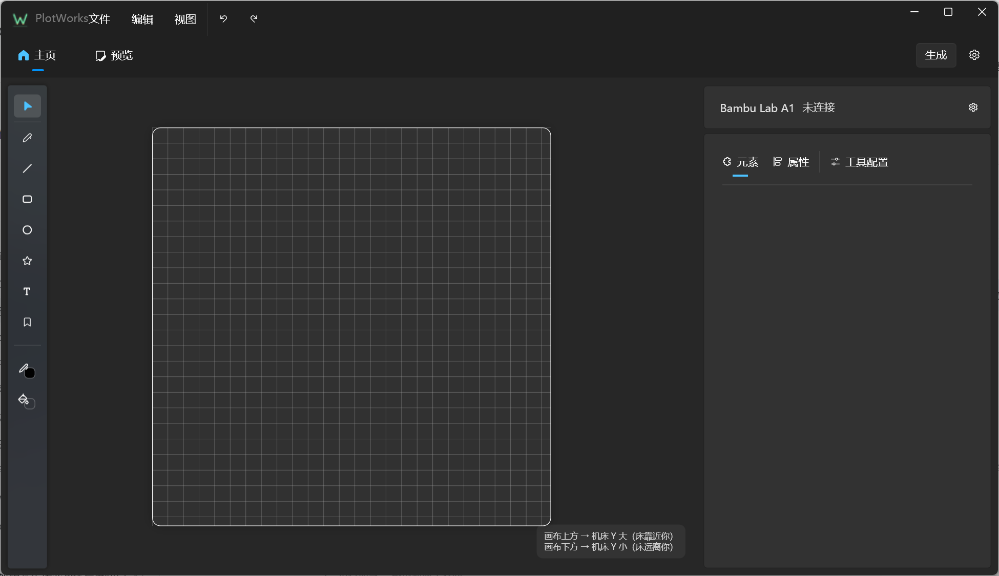

  
  
  

<b>把 Bambu Lab A1 变成一台笔绘机。</b> 
画图 → 生成 2D 刀路 → 局域网直传 → 在打印机屏幕上启动。

<i>Turn your Bambu Lab A1 into a pen plotter. Draw, generate 2D toolpaths, upload over LAN, start from the printer's screen.</i>

&nbsp;

# 这是什么

PlotWorks 是 [PolyCut](https://github.com/IridiumIO/PolyCut) 的一个魔改分支，**只面向 Bambu Lab A1**。

原版 PolyCut 是通用工具，靠 Klipper / Moonraker 与打印机通信。这一分支把那套路径全部换掉，改为直连 A1 自己的局域网协议：MQTT over TLS（8883）收状态、发 G-code，FTPS（990）上传待打印文件。界面、文档与内置字体均为中文。

最大的不同在字形：**内置 6,779 个汉字的单线骨架**。普通字体的字形是闭合轮廓，刻/写一遍要沿内外两条边走；单线字体每个笔画就是一条开放路径，一笔到位。所以中文能直接写出「陈伟♥林静」这样的连笔手写体，而不是空心字。

> A1 是 3D 打印机。装上笔或刀之后，它是一台定位精度高得多的 2D 绘图机——不需要再买一台刻字机。

# 现在能做什么

以下都在真机上跑过（详见 [Docs/trial-reports/STATUS.md](Docs/trial-reports/STATUS.md)）。

### 画布与编辑

- 导入 SVG / PNG / JPG / BMP（位图走 VTracer 矢量化）
- 多选、阵列复制、组合、布尔运算、镜像、旋转、缩放
- 直接画线、矩形、椭圆、星形、路径，以及输入文字
- 中文、英文、标点、拼音声调混排，行距逐行恒定
- 字号可自动缩到框内
- 项目保存为 `.polycut`，也可导出回 SVG

### 刀路生成

- 中文单线骨架 + 5 款内置 Hershey 单线拉丁字体
- 自定义起始 / 结束 G-code，落笔高度（`Work Z`）可调
- 工具头偏移与 Cut / Draw 模式各自的手动偏移
- 生成前提示缺字：没有骨架的字会列出，并整段回退为轮廓

### 与 A1 的连接

- 右下角 Printer Control：连接、回零（`G28`）、Jog、抬笔 / 落笔、实时状态
- 四角按钮把工具头移到已生成刀路的包围盒四角，方便对位
- 参考点捕获（画布上编号标记，可吸附，随项目保存）
- 位置校准：输入实测坐标，直接把累计坐标改回去
- Export 页 `Send to A1`：自动连接 → FTPS 上传 → 提示去屏幕上启动

# 已知限制

**A1 固件不允许从局域网远程开始打印。** `gcode_file` 被直接拒绝，`project_file` 返回成功但不会真正启动。所以上传之后必须到打印机屏幕上手动开始——这是 A1 的限制，不是本软件的缺陷。

其它：

- 不支持从局域网远程自动开始打印（同上）；`AutoPrint` 字段仅为兼容旧项目保留
- 没有视频流：A1 的 6000 端口是私有 TLS 协议，没有 RTSP
- MQTT 断线不会自动重连，需要手动点 `Connect`
- Jog 与四角移动是开环的：发送后不校验打印机响应，被固件拒绝时坐标仍会累加，需要用位置校准纠正
- 切割功能目前整体屏蔽（`UIConfiguration.EnableCutting = False`），等刀头设计定稿再开放。当前定位是**笔绘**
- 没有在线更新检查（已移除指向上游 PolyCut 仓库的更新服务），请手动获取新版本

# 快速开始

1. **打印机**：`设置 → 局域网模式`，开启局域网模式（A1 还需开启开发者模式），记下 IP、访问码、序列号
2. **配置连接**：右上角齿轮 → Printer Configuration → Bambu Lab A1 Connection，填 Host Address / Access Code / Serial Number
3. **连接**：Preview → Printer Control → `Connect`，Live status 出现 State / Nozzle / Bed 即成功
4. **对位**：`Home` 回零，用 Jog 走到已知点 → 输入实测坐标 → `Set as current position`
5. **生成并上传**：画好图 → 生成 → Export 页 `Send to A1` → 在打印机屏幕上启动

完整步骤与踩坑记录见 **[Docs/A1-README.md](Docs/A1-README.md)**。

> [!WARNING]
> **`Work Z` 默认是 5 mm，但必须按你实际的笔/刀安装高度确认一遍。** 对 A1 来说 Z=0 等于笔尖/刀尖贴床；落笔高度为负值时程序会直接拒绝（床面以下没有有效位置）。第一次使用前先量好高度再动。
>
> 访问码等于打印机的完整控制权，它以明文保存在 `%LocalAppData%\PlotWorks\Printers\*.json`，不要提交或截图分享。

# 安装

从 Releases 下载压缩包解压即用，不需要安装。压缩包内需保留 `Resources\Fonts\` 目录——5 款单线字体在里面，删了中文就写不成单线。

如果是框架依赖版（约 30 MB），还需要装 .NET 10 Desktop Runtime；自包含版（约 150 MB）不需要。

程序是便携式的：配置文件默认写到 `%LocalAppData%\PlotWorks`；如果把程序放在任意名为 `PlotWorks`（或旧版遗留的 `PolyCut`）的目录里，就会改用该目录下的 `.PlotWorksData`，从而实现完全便携。

> 配置目录自本分支起改为 `%LocalAppData%\PlotWorks`。如果你之前跑过上游或早期版本，打印机配置还留在 `%LocalAppData%\IridiumIO\PolyCut`，手动复制过来即可。

# 要求

### 系统

- Windows 10 v1809 或更高（Mica 效果需要 Windows 11）
- Bambu Lab A1，已开启局域网模式；上传与启动还需开发者模式

### 硬件

需要一个能夹在工具头上的笔架或刀架。3D 打印模型可以在 Printables / Thingiverse 上找。

**强烈建议选带弹簧的那种。** 打印机的床远没有达到稳定刻透不干胶所需的平面度，弹簧能提供一点柔性，让笔尖/刀尖始终贴合纸面。

从 3D 打印切回笔绘、再切回去的 Klipper 宏方案（本项目已不依赖 Klipper，但这份说明对 A1 的宏仍可参考）：[Data/Klipper Setup.md](Data/Klipper%20Setup.md)

# 许可与出处

本项目是 [PolyCut](https://github.com/IridiumIO/PolyCut)（作者 [@IridiumIO](https://github.com/IridiumIO)）的衍生作品，遵循 **GNU General Public License v3.0** 发布，完整条款见 [LICENSE.txt](LICENSE.txt)。

- 界面、通讯层（A1 MQTT/FTPS）、中文单线字体与汉化由本分支添加
- 字形数据来自 Hershey 矢量字体（Dr. A. V. Hershey / U.S. National Bureau of Standards，1967），见 [Docs/fonts.md](Docs/fonts.md)
- 上游项目仍然值得支持：

如果你 fork 或再分发，请同样保留上述出处与 GPL 条款。
